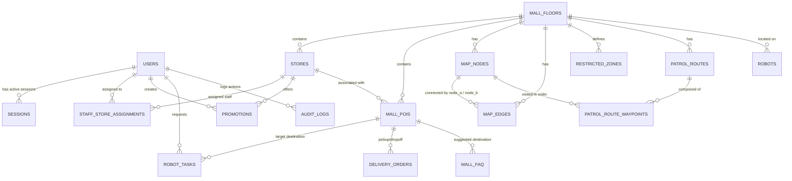

# DATABASE SCHEMA SPECIFICATION (v2.0)

**Hệ thống cơ sở dữ liệu:** SQLite (WAL Mode, `PRAGMA foreign_keys = ON;`)  
**Tập tin lưu trữ:** `data/mall_delivery.db`  
**Cơ chế di trú:** `src/database/migrator.py` (tự động tạo bản sao lưu `.backup_<timestamp>` trước khi áp dụng migration).

---

## 1. SƠ ĐỒ THỰC THỂ QUAN HỆ (ERD - ENTITY RELATIONSHIP DIAGRAM)

---

## 2. DANH MỤC CÁC BẢNG VÀ CHI TIẾT CẤU TRÚC

### 2.1. Quản lý Người dùng & Phiên Đăng Nhập (Users & Sessions)

#### Bảng `users`
| Cột | Kiểu | Ràng buộc | Mô tả |
| :--- | :--- | :--- | :--- |
| `id` | `TEXT` | `PRIMARY KEY` | Định danh người dùng (vd: `usr_admin`) |
| `username` | `TEXT` | `UNIQUE NOT NULL` | Tên đăng nhập |
| `password_hash`| `TEXT` | `NOT NULL` | Mật khẩu băm (bcrypt cost 12 / PBKDF2) |
| `full_name` | `TEXT` | `NOT NULL` | Họ tên hiển thị |
| `role` | `TEXT` | `NOT NULL CHECK('guest','staff','admin')` | Vai trò phân quyền |
| `is_active` | `INTEGER`| `NOT NULL DEFAULT 1` | Cờ trạng thái tài khoản |
| `created_at` | `REAL` | `NOT NULL` | Thời gian tạo (Unix timestamp) |
| `updated_at` | `REAL` | `NOT NULL` | Thời gian cập nhật gần nhất |

#### Bảng `sessions`
| Cột | Kiểu | Ràng buộc | Mô tả |
| :--- | :--- | :--- | :--- |
| `token` | `TEXT` | `PRIMARY KEY` | Session token bí mật (64 ký tự hex) |
| `user_id` | `TEXT` | `NOT NULL REFERENCES users(id) ON DELETE CASCADE` | Khóa ngoại tới người dùng |
| `expires_at` | `REAL` | `NOT NULL` | Thời điểm hết hạn phiên |
| `created_at` | `REAL` | `NOT NULL` | Thời điểm đăng nhập |
| `last_active`| `REAL` | `NOT NULL` | Lần hoạt động gần nhất |
| `ip_address` | `TEXT` | | Địa chỉ IP của client |
| `user_agent` | `TEXT` | | Trình duyệt / thiết bị client |

#### Bảng `staff_store_assignments`
| Cột | Kiểu | Ràng buộc | Mô tả |
| :--- | :--- | :--- | :--- |
| `id` | `TEXT` | `PRIMARY KEY` | Mã phân công |
| `user_id` | `TEXT` | `NOT NULL REFERENCES users(id) ON DELETE CASCADE` | Nhân viên |
| `store_id` | `TEXT` | `NOT NULL REFERENCES stores(id) ON DELETE CASCADE` | Cửa hàng được gán |
| `created_at` | `REAL` | `NOT NULL` | Thời gian tạo |
| *(Unique)* | | `UNIQUE(user_id, store_id)` | Mỗi nhân viên chỉ liên kết 1 lần/cửa hàng |

---

### 2.2. Không gian Trung Tâm Thương Mại & Điểm Đến (Mall Entities & POIs)

#### Bảng `mall_floors`
| Cột | Kiểu | Ràng buộc | Mô tả |
| :--- | :--- | :--- | :--- |
| `id` | `TEXT` | `PRIMARY KEY` | Mã tầng (vd: `floor_t1`) |
| `name` | `TEXT` | `NOT NULL` | Tên tầng ("Tầng 1 - Sảnh Thương Mại") |
| `level_index`| `INTEGER`| `NOT NULL UNIQUE` | Chỉ số tầng (1, 2, 3...) |
| `map_image_url`| `TEXT` | | URL bản đồ sàn đồ họa |
| `width_m` | `REAL` | `NOT NULL DEFAULT 100.0` | Kích thước chiều ngang thực tế (mét) |
| `height_m` | `REAL` | `NOT NULL DEFAULT 100.0` | Kích thước chiều dọc thực tế (mét) |
| `created_at` | `REAL` | `NOT NULL` | Thời gian tạo |

#### Bảng `stores`
| Cột | Kiểu | Ràng buộc | Mô tả |
| :--- | :--- | :--- | :--- |
| `id` | `TEXT` | `PRIMARY KEY` | Mã cửa hàng (vd: `store_uniqlo`) |
| `name` | `TEXT` | `NOT NULL` | Tên cửa hàng |
| `category` | `TEXT` | `NOT NULL` | Danh mục (`fashion`, `food`, `entertainment`, `utility`, `staff`) |
| `floor_id` | `TEXT` | `NOT NULL REFERENCES mall_floors(id) ON DELETE RESTRICT` | Tầng |
| `x`, `y` | `REAL` | `NOT NULL` | Tọa độ tâm cửa hàng (%) |
| `width`, `height` | `REAL` | `DEFAULT 15.0` | Kích thước ô gian hàng |
| `description`| `TEXT` | | Giới thiệu gian hàng |
| `contact_phone`| `TEXT`| | Số điện thoại liên hệ |
| `opening_hours`| `TEXT`| | Khung giờ hoạt động |
| `is_active` | `INTEGER`| `NOT NULL DEFAULT 1` | Trạng thái hoạt động |
| `created_at` | `REAL` | `NOT NULL` | Thời gian tạo |

#### Bảng `mall_pois`
| Cột | Kiểu | Ràng buộc | Mô tả |
| :--- | :--- | :--- | :--- |
| `id` | `TEXT` | `PRIMARY KEY` | Mã điểm đến (vd: `poi_reception`, `poi_wc`) |
| `name` | `TEXT` | `NOT NULL` | Tên điểm đến hiển thị trên bản đồ |
| `category` | `TEXT` | `NOT NULL` | Nhóm danh mục |
| `floor_id` | `TEXT` | `NOT NULL REFERENCES mall_floors(id) ON DELETE RESTRICT` | Tầng |
| `x`, `y` | `REAL` | `NOT NULL` | Tọa độ điểm đón trả khách (%) |
| `description`| `TEXT` | | Mô tả chi tiết |
| `is_staff_only`| `INTEGER`| `NOT NULL DEFAULT 0` | Cờ khu vực nội bộ nhân viên |
| `store_id` | `TEXT` | `REFERENCES stores(id) ON DELETE SET NULL` | Cửa hàng tương ứng (nếu có) |
| `created_at` | `REAL` | `NOT NULL` | Thời gian tạo |

---

### 2.3. Bản Đồ Graph Điều Hướng (Navigation Graph)

#### Bảng `map_nodes`
| Cột | Kiểu | Ràng buộc | Mô tả |
| :--- | :--- | :--- | :--- |
| `id` | `TEXT` | `PRIMARY KEY` | Mã đỉnh (Node ID) |
| `floor_id` | `TEXT` | `NOT NULL REFERENCES mall_floors(id) ON DELETE CASCADE` | Tầng |
| `name` | `TEXT` | | Tên gợi nhớ của đỉnh |
| `x`, `y` | `REAL` | `NOT NULL` | Tọa độ vị trí đỉnh (%) |
| `node_type` | `TEXT` | `CHECK('path','poi','charging','intersection','corridor','entrance')` | Loại đỉnh |
| `created_at` | `REAL` | `NOT NULL` | Thời gian tạo |

#### Bảng `map_edges`
| Cột | Kiểu | Ràng buộc | Mô tả |
| :--- | :--- | :--- | :--- |
| `id` | `TEXT` | `PRIMARY KEY` | Mã cạnh (Edge ID) |
| `floor_id` | `TEXT` | `NOT NULL REFERENCES mall_floors(id) ON DELETE CASCADE` | Tầng |
| `node_a` | `TEXT` | `NOT NULL REFERENCES map_nodes(id) ON DELETE CASCADE` | Đỉnh đầu |
| `node_b` | `TEXT` | `NOT NULL REFERENCES map_nodes(id) ON DELETE CASCADE` | Đỉnh cuối |
| `distance_m` | `REAL` | `NOT NULL` | Khoảng cách đường đi (mét) |
| `is_bidirectional`| `INTEGER`| `NOT NULL DEFAULT 1` | Đường 2 chiều (1) hoặc 1 chiều (0) |
| `is_blocked` | `INTEGER`| `NOT NULL DEFAULT 0` | Đang bị chặn bởi vật cản tạm thời (1/0) |
| `created_at` | `REAL` | `NOT NULL` | Thời gian tạo |
| *(Unique)* | | `UNIQUE(floor_id, node_a, node_b)` | Tránh trùng lặp cạnh |

#### Bảng `restricted_zones`
| Cột | Kiểu | Ràng buộc | Mô tả |
| :--- | :--- | :--- | :--- |
| `id` | `TEXT` | `PRIMARY KEY` | Mã vùng cấm |
| `floor_id` | `TEXT` | `NOT NULL REFERENCES mall_floors(id) ON DELETE CASCADE` | Tầng |
| `name` | `TEXT` | `NOT NULL` | Tên vùng (vd: "Khu Vực Thi Công") |
| `x_min`, `y_min`, `x_max`, `y_max` | `REAL` | `NOT NULL` | Tọa độ hình chữ nhật bao quanh vùng cấm |
| `is_active` | `INTEGER`| `NOT NULL DEFAULT 1` | Kích hoạt vùng cấm |
| `created_at` | `REAL` | `NOT NULL` | Thời gian tạo |

#### Bảng `patrol_routes` & `patrol_route_waypoints`
- Quản lý danh sách tuyến tuần tra và thứ tự các đỉnh cần đi qua khi robot rảnh rỗi quá 5 phút.

---

### 2.4. Khuyến Mãi & Trợ Lý Tri Thức (Promotions & FAQ)

#### Bảng `promotions`
| Cột | Kiểu | Ràng buộc | Mô tả |
| :--- | :--- | :--- | :--- |
| `id` | `TEXT` | `PRIMARY KEY` | Mã khuyến mãi |
| `title` | `TEXT` | `NOT NULL` | Tiêu đề ưu đãi |
| `store_id` | `TEXT` | `NOT NULL REFERENCES stores(id) ON DELETE CASCADE` | Cửa hàng phát hành |
| `description`| `TEXT` | | Nội dung chi tiết |
| `discount_percent`| `INTEGER`| | Phần trăm giảm giá (nếu có) |
| `promo_code`| `TEXT` | | Mã giảm giá |
| `banner_url`| `TEXT` | | Ảnh banner |
| `start_time`| `REAL` | `NOT NULL` | Bắt đầu áp dụng |
| `end_time` | `REAL` | `NOT NULL` | Kết thúc áp dụng |
| `is_active` | `INTEGER`| `NOT NULL DEFAULT 1` | Trạng thái hiển thị |
| `created_by`| `TEXT` | `REFERENCES users(id) ON DELETE SET NULL` | Người tạo |
| `created_at`, `updated_at` | `REAL` | `NOT NULL` | Thời gian tạo và cập nhật |

#### Bảng `mall_faq`
- Lưu trữ các câu hỏi thường gặp về Wi-Fi, bãi đỗ xe, phòng vệ sinh, giờ hoạt động để cấp cho AI Concierge hoặc tra cứu nhanh.

---

### 2.5. Nhiệm Vụ & Vận Chuyển Hàng Nội Bộ (Tasks & Delivery Orders)

#### Bảng `robot_tasks`
- Quản lý vòng đời nhiệm vụ: `escort` (dẫn đường), `delivery` (giao hàng), `patrol` (tuần tra), `manual` (lái thủ công).

#### Bảng `delivery_orders`
- Lưu trữ bền vững các đơn hàng vận chuyển hàng hóa nội bộ giữa các gian hàng và kho, theo dõi tiến độ từng chặng từ lúc lấy hàng đến lúc giao xong.

#### Bảng `audit_logs`
- Ghi nhật ký mọi hành vi can thiệp hệ thống nhạy cảm (Đăng nhập, tạo khuyến mãi, cập nhật bản đồ, đổi quyền nhân viên, điều khiển thủ công, kích hoạt dừng khẩn cấp).

---

## 3. QUY TRÌNH DI TRÚ (MIGRATION & ROLLBACK)

1. **Backup tự động:** Mỗi lần chạy `run_database_migrations()`, hệ thống sao lưu file SQLite hiện tại sang `data/mall_delivery.db.backup_<timestamp>`.
2. **Theo dõi phiên bản:** Bảng `schema_migrations` lưu lại các script đã thực thi thành công.
3. **Rollback an toàn:** Nếu có sự cố, khôi phục ngay bằng cách ghi đè file `.backup_<timestamp>` tương ứng trở lại `data/mall_delivery.db`.
