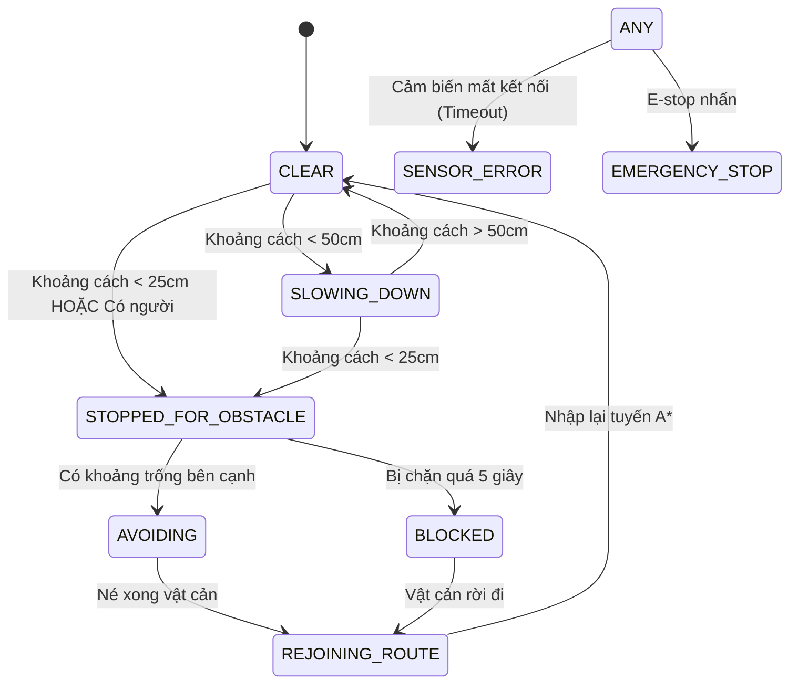

# THỊ GIÁC MÁY TÍNH CỔ ĐIỂN & HỆ THỐNG AN TOÀN TRÁNH VẬT CẢN (VISION & SAFETY)

Tài liệu kỹ thuật về pipeline xử lý ảnh OpenCV cổ điển (loại bỏ hoàn toàn pretrained deep learning models), máy trạng thái hữu hạn tránh vật cản HC-SR04 và kiến trúc an toàn nhiều tầng.

---

## 1. THỊ GIÁC MÁY TÍNH CỔ ĐIỂN (CLASSICAL OPENCV PIPELINE)

Theo yêu cầu nghiêm ngặt của đề tài, module phát hiện người đã loại bỏ hoàn toàn mô hình deep learning SSD MobileNet V2 pretrained (`.tflite`) để tránh phụ thuộc vào trọng số tải sẵn và giảm tải nhiệt độ CPU trên Raspberry Pi 4.

Lớp triển khai: `src/vision/person_detector.py` (`PersonDetector`).

### 1.1. Các bước trong pipeline xử lý
1. **Tiền xử lý & Giảm độ phân giải (Downscaling):**
   - Frame ảnh từ CSI camera (640x480) được downscale xuống bề rộng $320\text{ px}$ (tỷ lệ giữ nguyên 320x240).
   - Chuyển đổi sang ảnh xám (Grayscale) để triệt tiêu độ phức tạp kênh màu.
   - Thời gian xử lý: $\approx 1.2\text{ ms}$.
2. **Khấu trừ nền & Phát hiện vùng chuyển động (MOG2 Background Subtraction):**
   - Thuật toán `cv2.createBackgroundSubtractorMOG2(history=150, varThreshold=25, detectShadows=False)`.
   - Lọc bỏ nền tĩnh của trung tâm thương mại (sàn gạch, cột nhà, quầy hàng).
   - Áp dụng các phép biến đổi hình thái học (Morphology Open & Dilate) với kernel $3\times3$ để loại bỏ nhiễu hạt lấm chấm.
3. **Bộ phân loại HOG + Tuyến tính SVM (Dalal & Triggs People Detector):**
   - Sử dụng bộ trích xuất đặc trưng Histogram of Oriented Gradients tích hợp sẵn trong OpenCV:
     `hog.setSVMDetector(cv2.HOGDescriptor_getDefaultPeopleDetector())`.
   - Chạy `detectMultiScale(winStride=(8,8), padding=(4,4), scale=1.08)`.
4. **Lọc hình học theo tỷ lệ người (Aspect Ratio Filtering):**
   - Người đứng thẳng có tỷ lệ chiều cao/chiều rộng $1.1 \le \frac{h}{w} \le 4.5$.
   - Lọc bỏ các khối chuyển động ngang (ví dụ: xe đẩy hàng thấp, balo đặt trên sàn).
5. **Xác định Vùng Dừng Khẩn Cấp (Safety Stop Zone):**
   - Khu vực trung tâm theo chiều ngang: $X_{\text{center}} \in [0.20, 0.80]$.
   - Nếu tâm của bounding box nằm trong hành lang trực diện của robot, cờ `has_person_in_stop_zone` được bật để kích hoạt phanh an toàn.

### 1.2. Đánh giá thực nghiệm hiệu năng trên Raspberry Pi 4
- **Độ trễ xử lý (Inference Latency):** $8.5\text{ ms} - 12.0\text{ ms}$ cho mỗi frame.
- **Tốc độ khung hình (Vision FPS):** Đạt ổn định $25 - 30\text{ FPS}$ trên CPU ARM Cortex-A72.
- **Mức chiếm dụng CPU:** Dưới $35\%$ cho 1 core CPU, không gây hiện tượng quá nhiệt hay tụt xung (thermal throttling).

> [!WARNING]
> **GIỚI HẠN THUẬT TOÁN (ALGORITHM LIMITATIONS):**
> 
> Thuật toán cổ điển HOG + SVM và MOG2 có độ chính xác phụ thuộc mạnh vào điều kiện chiếu sáng:
> - Người đứng yên tuyệt đối quá lâu sẽ dần bị MOG2 hòa lẫn vào nền tĩnh.
> - Ánh sáng đèn flash chói hoặc bóng đổ mạnh có thể tạo vùng nhiễu giả.
> - Do đó, **THỊ GIÁC CAMERA KHÔNG ĐƯỢC PHÉP LÀ LỚP AN TOÀN DUY NHẤT**. Robot bắt buộc phải có lớp cảm biến siêu âm HC-SR04 độc lập làm chốt chặn an toàn tối thượng.

---

## 2. HỢP NHẤT DỮ LIỆU CẢM BIẾN & MÁY TRẠNG THÁI TRÁNH VẬT CẢN (OBSTACLE FSM)

Lớp triển khai: `src/vision/obstacle_avoidance.py` (`ObstacleAvoidanceController`).

### 2.1. Các trạng thái hoạt động (Finite States)

1. **`CLEAR`**: Đường đi hoàn toàn thông thoáng ($d > 50\text{ cm}$). Robot chạy tốc độ danh định.
2. **`OBSTACLE_DETECTED` / `SLOWING_DOWN`**: Cảm biến siêu âm ghi nhận vật cản cách $25\text{ cm} \le d \le 50\text{ cm}$. Tốc độ robot tự động giảm về $50\%$ để chuẩn bị dừng nếu vật cản tiếp tục tiến lại gần.
3. **`STOPPED_FOR_OBSTACLE`**: Khoảng cách $d < 25\text{ cm}$ hoặc phát hiện người đi bộ cắt ngang hành lang. Robot phanh dừng hoàn toàn, còi/OLED phát tín hiệu xin nhường đường.
4. **`AVOIDING`**: Đánh giá chênh lệch giữa hai cảm biến trái/phải ($d_L$ và $d_R$). Robot xoay nhẹ về hướng có khoảng trống lớn hơn nếu vùng đó nằm trong phạm vi cảm biến bao quát.
5. **`REJOINING_ROUTE`**: Sau khi vượt qua chướng ngại, robot sử dụng A* planner để tái định tuyến nhập lại điểm waypoint kế tiếp.
6. **`BLOCKED`**: Bị chặn đứng quá $5.0\text{ giây}$ mà không thể né. Robot chuyển sang chế độ đứng yên, gửi cảnh báo về Dashboard nhân viên và hủy nhiệm vụ nếu timeout.
7. **`SENSOR_ERROR`**: Cả hai cảm biến siêu âm bị mất tín hiệu hoặc timeout quá thời hạn. Chuyển sang trạng thái an toàn fail-safe, cấm mọi lệnh tự hành.
8. **`EMERGENCY_STOP`**: Lệnh dừng khẩn cấp từ nút bấm vật lý, API hoặc WebSocket. Ngắt hoàn toàn tín hiệu điều khiển động cơ.

### 2.2. Giới hạn vật lý của cảm biến siêu âm HC-SR04
- Góc quét hình nón của HC-SR04 chỉ đạt khoảng $15^\circ - 30^\circ$.
- Robot hiện chỉ trang bị 2 cảm biến phía trước. **ROBOT CÓ ĐIỂM MÙ HOÀN TOÀN Ở HAI BÊN HÔNG VÀ PHÍA SAU**.
- Do đó, thuật toán né vật cản **TUYỆT ĐỐI KHÔNG TỰ Ý LÙI XE HOẶC QUAY NGOẶT $90^\circ$** nếu không có cảm biến quét ở góc tương ứng.
